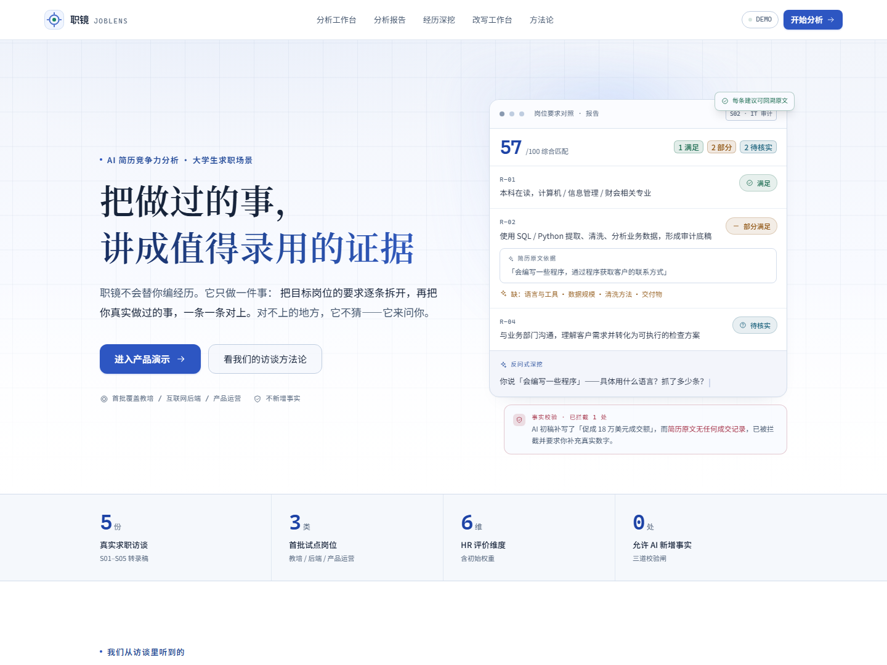

# 职镜 JobLens

> 面向大学生求职场景的 **AI 简历竞争力分析与优化平台** · 前端 Demo
>
> **把做过的事，讲成值得录用的证据。**
> 不替你编经历，只帮你把真实做过的事，逐条对准目标岗位。

<p>
  
  
  
  
</p>

---

## 在线演示

🔗 **<https://jch190877-oss.github.io/joblens/>**

推送到 `main` 后由 GitHub Actions 自动构建发布，通常 1 分钟内生效。



---

## 这是什么

这是一个**纯前端**产品原型，用来在答辩 / 路演现场演示产品完整链路。预设案例的分析结果来自人工编写的 requirements + 规则计算；自定义材料走本地解析与规则匹配。**目前不含后端与真实模型调用。**

> 📘 **接手开发请先读 [`HANDOFF.md`](HANDOFF.md)**（所有地址、路由、数据模型、环境坑、已知问题、演示动线）
> 📄 **给评委看的完整说明见 [`docs/产品说明.md`](docs/产品说明.md)**

产品的判断依据来自 **7 份访谈**：5 位已拿到优质实习 / 大厂 offer 的同学（S01–S05），以及 2 位正在做招聘的 HR（HR01–HR02）。

## 演示动线（90 秒）

| 步骤 | 页面 | 看点 |
| --- | --- | --- |
| 1 | `#/` 首页 | 一份**正在被修改的简历**——不是报告，是简历 |
| 2 | `#/upload` 上传 | 文件 / 截图 / 文本三种输入，本地解析 + 6 项体检 |
| 3 | `#/analyze` 自定义对照 | 自己的简历 + 自己的 JD → 逐条判定 + 证据原句 |
| 4 | `#/report` 对照报告 | **总分可逐行复算** + 四态判定 + 原文依据 |
| 5 | `#/deepdive` 经历深挖 | ★ 核心交互：AI 反问，你答事实，实时拼出证据 |
| 6 | `#/resume` 简历页 | 采纳后那一行立即改写，导出投递版 |
| 7 | `#/method` 方法论 | 7 位受访者、HR 视角、**两处分歧**、证据边界 |

**演示捷径**：

```
?sample=1#/upload     预填示例简历
?demo=1#/analyze      预填简历 + JD 并直接跑出对照
?fill=1#/deepdive     预填深挖答案，展示证据卡完成态
```

## 快速开始

```bash
# 依赖（pnpm 或 npm 都行）
pnpm install
# npm install

# 开发
pnpm dev            # http://localhost:5173

# 构建 + 本地预览（产物在 dist/）
pnpm build
pnpm preview        # http://localhost:4173
```

> ⚠️ 不要直接双击 `dist/index.html`。现代浏览器会以 CORS 策略拦截 `file://` 下的 ES module，页面会白屏。请用 `pnpm preview`（仓库内自带的极简静态服务器）或任意静态托管。

## 目录结构

```
joblens/
├─ src/
│  ├─ data/demo.ts          ← 所有演示内容都在这里（3 个案例 + 访谈洞察）
│  ├─ views/                ← 6 个页面
│  │  ├─ Landing.tsx        首页
│  │  ├─ Workbench.tsx      分析工作台（三步）
│  │  ├─ Report.tsx         对照报告
│  │  ├─ Deepdive.tsx       反问式深挖
│  │  ├─ Rewrite.tsx        改写工作台
│  │  └─ Method.tsx         方法论
│  ├─ components/           ← Layout / 通用 UI / 图标
│  ├─ lib/                  ← 哈希路由、案例状态
│  ├─ App.tsx
│  └─ index.css             ← 设计令牌（配色、字体、动效）
├─ scripts/serve.mjs        ← 本地静态预览服务器
├─ docs/                    ← 部署指南、产品说明
└─ .github/workflows/       ← GitHub Pages 自动部署
```

## 想改点什么

| 想改 | 去哪 |
| --- | --- |
| 案例内容、JD、评分、改写建议 | `src/data/demo.ts`（只改这个文件即可） |
| 首页文案 | `src/views/Landing.tsx` |
| 配色 / 字体 / 动效 | `src/index.css` 顶部的 `@theme` 区块 |
| 导航栏菜单 | `src/lib/router.ts` 的 `NAV` |
| 加一个新页面 | 在 `src/views/` 建文件 → `src/App.tsx` 里加一个 `case` → `NAV` 加一项 |

## 技术选择说明

- **哈希路由**（`#/report`）而不是 history 路由：构建产物可以直接部署到 GitHub Pages、对象存储等**任意静态托管**，不需要服务端 rewrite 规则，换托管方零成本。
- **`base: './'`**：资源用相对路径，放在子目录（如 `xxx.github.io/joblens/`）也能正常加载。
- **零运行时依赖**：除 React 外没有引入路由库、图标库、UI 库。图标是手写 SVG，路由 30 行。团队新同学不用先学一堆框架。
- **Tailwind 4**（CSS-first 配置）：设计令牌集中在 `src/index.css`，改配色只改一处。

## 部署

一行命令产出 `dist/`，然后交给任意静态托管。评委链接的选型与操作步骤见：

👉 **[docs/部署与协作指南.md](docs/部署与协作指南.md)**

已内置 GitHub Actions：推送到 `main` 自动构建并发布到 GitHub Pages。

## 已知边界

- 分析结果为预置数据，**AI 链路（JD 拆解、反问生成、事实校验器）尚未接入**。
- 案例已匿名化；原始访谈转录稿**不进入本仓库**（见部署指南的隐私提醒）。
- 报告分数用于定位问题、排序修改优先级，**不用于预测录用结果**。

## License

仅用于本项目参赛与教学演示。
